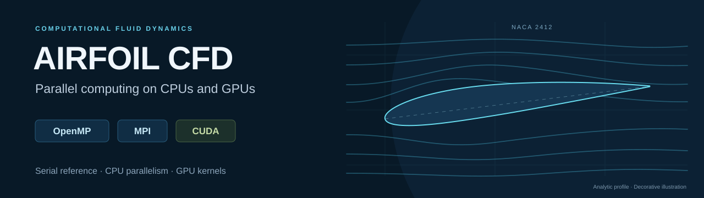
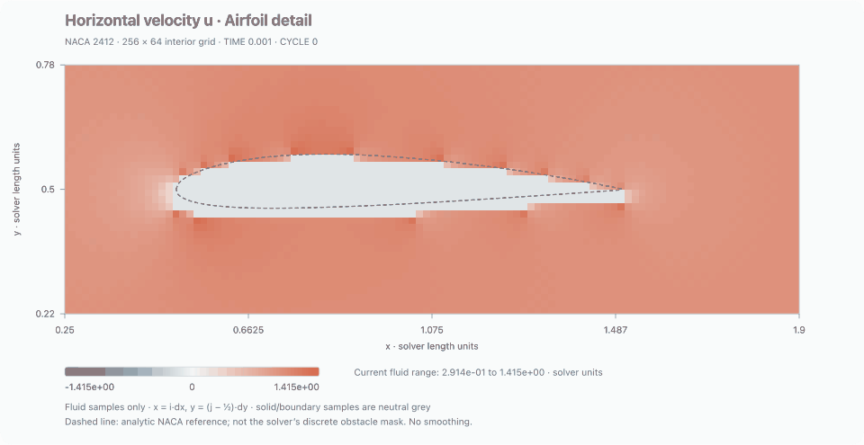
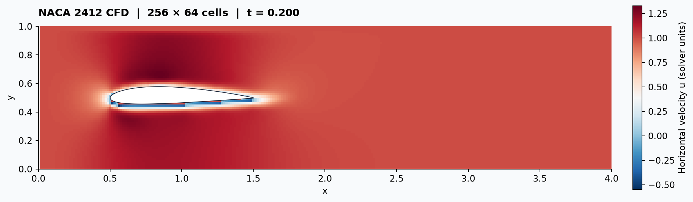
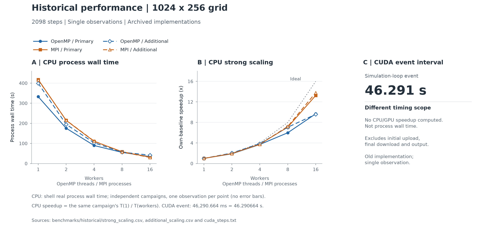
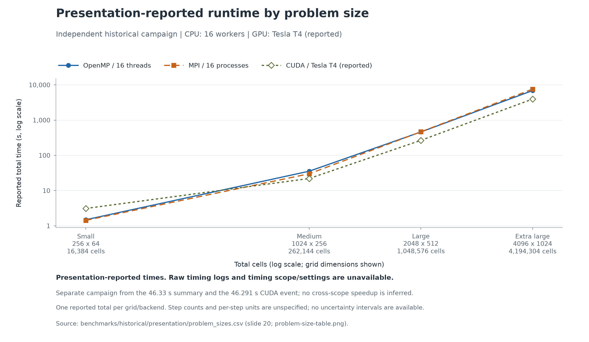

<p align="center">
  
</p>

<p align="center">
  <strong>A two-dimensional flow solver with OpenMP, MPI and custom CUDA kernels.</strong><br>
  Numerical checks, inspectable measurements and reproducible builds.
</p>

<p align="center">
  <a href="https://github.com/SakuraUltra/hipc-airfoil/actions/workflows/ci.yml"></a>
  
  
  
  
  
</p>

<p align="center">
  <a href="#one-command-demo">Try the demo</a> &nbsp;·&nbsp;
  <a href="#overview">Overview</a> &nbsp;·&nbsp;
  <a href="#implementations">Implementations</a> &nbsp;·&nbsp;
  <a href="#performance-evidence">Performance</a> &nbsp;·&nbsp;
  <a href="#build-and-run">Quickstart</a> &nbsp;·&nbsp;
  <a href="#validate-first">Validation</a> &nbsp;·&nbsp;
  <a href="#documentation">Documentation</a>
</p>

## One-command demo

Run a NACA 2412 simulation and play its evolution in your browser:

```sh
git clone https://github.com/SakuraUltra/hipc-airfoil.git
cd hipc-airfoil
make demo
```



*Preview: 41 actual saved states, 256×64 grid, TIME 0.001–0.4. The colour scale
is fixed; grey marks excluded solid/boundary samples. [Preview source metadata](docs/assets/demo-flow.json).*

Needs a **C11 compiler, Make and Python 3.10+** on macOS or Linux. No GPU,
OpenMP runtime or Python packages are needed. The command builds both serial
implementations on a **256×64 grid**, checks their complete velocity and pressure
fields at every saved time, and prints the path to an **offline `index.html`**.
Play/pause the actual computed frames, scrub through time, switch velocity/pressure,
or toggle the airfoil close-up and full domain. Open the file in your browser;
it needs no web server or internet. Use `make demo-hd` for a finer **512×128 grid**.

Every invocation keeps a fresh `out/demo/run-*/` folder with the page, SVG figures,
raw time-dependent fields, logs and a JSON report. Failed runs retain diagnostic evidence and do
not produce a success page. This short demonstration illustrates numerical
agreement; it is not a performance benchmark or physical validation of the model.
See the [demo guide](docs/DEMO.md) for prerequisites, output details and options.

## Overview

This project explores how a NACA-airfoil CFD solver maps onto shared-memory
CPUs, distributed-memory processes and GPUs. It extends an existing serial
finite-difference implementation with parallel backends, numerical comparison
tools and traceable historical performance evidence.

| Parallel computing | Numerical checks | Performance evidence |
| --- | --- | --- |
| OpenMP loops, MPI halo exchange and CUDA stencil kernels | Complete velocity/pressure fields, checkpoints and uneven decompositions | Original logs, checked tables, reproducible figures and explicit timing scopes |

<p align="center">
  
</p>

*Actual maintained-solver output: NACA 2412, 256×64 cells, fixed timestep 0.001,
simulation time 0.200. This is a diagnostic illustration, not physical validation
of the CFD model.*

[Source provenance](docs/PROVENANCE.md) distinguishes the inherited serial
reference, archived implementations and maintained code.

## Implementations

| Executable | Main implementation |
| --- | --- |
| `build/airfoil_serial` | Corrected serial comparison baseline |
| `build/airfoil_serial_opt` | Precomputed reciprocals and direct checkerboard traversal |
| `build/airfoil_openmp` | Parallel loops with sum/max reductions |
| `build/airfoil_openmp_opt` | Shared parallel regions, collapsed loops and static work sharing |
| `build/airfoil_mpi` | X-slab decomposition, halo exchange and global reductions |
| `build/airfoil_cuda` | Device-resident stencil kernels and two-stage reductions |

All maintained variants retain the same solver stages and inherited velocity
update ranges. See [architecture](docs/ARCHITECTURE.md) for synchronization,
boundary treatment and limitations.

## Performance evidence

Original cluster measurements are retained in the
[historical data archive](benchmarks/historical/README.md), including raw logs,
run scripts, build configurations and profiles. All four available CPU scaling
campaigns are shown below, with one observation per worker count on a single
CPU node. Each row is a separate campaign, not a repeated-run aggregate:

| 1024×256 workload / source log | 1 worker | 16 workers | Speedup vs own 1-worker run |
| --- | ---: | ---: | ---: |
| [OpenMP · 27579401](benchmarks/historical/omp_scaling_27579401.out) | 332.667 s | 34.389 s | 9.674× |
| [OpenMP · 27404398](benchmarks/historical/additional/strong_scaling_27404398.out) | 399.462 s | 41.682 s | 9.584× |
| [MPI · 27437194](benchmarks/historical/mpi_scaling_27437194.out) | 417.738 s | 31.535 s | 13.247× |
| [MPI · 27232003](benchmarks/historical/additional/mpi_test_27232003.out) | 416.107 s | 30.173 s | 13.791× |



*CPU curves retain each campaign separately and use its own one-worker baseline.
The CUDA panel has a different timing scope. These observations do not establish
a common serial-baseline or CPU/GPU speedup comparison. The presentation's
separately archived ratios use its reported 378.57 s serial baseline.*

The CUDA records below are preserved with their original measurement labels:

| Historical CUDA record | Time | Timing scope / source |
| --- | ---: | --- |
| Raw solver log | **46.290664 s** | CUDA event interval, from [46290.664 ms](benchmarks/historical/cuda_steps.txt); excludes initial upload and final download/output |
| Presentation summary, slide 19 | **46.33 s** | Reported process `real` time; [source table](benchmarks/historical/presentation/summary-table.png), underlying shell timing log unavailable |

The presentation also reports the following separate problem-size campaign.
CPU configurations use 16 workers; its source chart labels the GPU **Tesla T4**:

| Grid | MPI, 16 processes | OpenMP, 16 threads | CUDA, reported time |
| --- | ---: | ---: | ---: |
| 256×64 | 1.43 s | 1.49 s | 3.11 s |
| 1024×256 | 30.01 s | 35.50 s | **22.04 s** |
| 2048×512 | 465.55 s | 460.79 s | 266.66 s |
| 4096×1024 | 7564.00 s | 6889.00 s | 3954.56 s |



*Source: [slide 20 table](benchmarks/historical/presentation/problem-size-table.png),
[transcribed data](benchmarks/historical/presentation/problem_sizes.csv), and
[slide 18 chart](benchmarks/historical/presentation/problem-size-chart.png).
Timing boundaries, exact binaries and run settings for this campaign are not
available. The 22.04 s, 46.33 s and 46.290664 s CUDA records remain separate;
they do not establish a measured improvement between code versions.*

All performance values above describe **earlier implementations**. They are
single observations, without repeated-run uncertainty or multi-node scaling.
The maintained CUDA code has passed Linux compilation checks; **its GPU runtime
correctness and performance have not yet been measured**. Full timing and source
details are in the [historical data index](benchmarks/historical/README.md).

Performance values in the archived logs are preserved; listed privacy edits
remove identifying metadata only. The [manifest](benchmarks/historical/manifest.json)
records original and retained file hashes. Check file integrity, raw-log timing
summaries and presentation-table structure without running a simulation:

```sh
python3 scripts/check_historical.py
```

Local Mac tests use a separate workload and do not establish cluster performance.
Choose cluster optimisations using matched tests on the target cluster; new
measurements must not replace these historical observations.

Collect fresh repeated full-process wall times with an unchanged workload:

```sh
make info
python3 scripts/benchmark.py --backend serial serial-opt openmp openmp-opt mpi \
  --workers 1 2 4 --nx 256 --ny 64 --end-time .02 --dt .001 \
  --warmups 1 --repeats 3 --output benchmarks/results/scaling-256x64
```

CSV, JSON, toolchain/source hashes and per-run logs keep the measurement scope
inspectable. Short smoke runs verify the harness; meaningful scaling results
need representative workloads and controlled hardware. See
[benchmark methodology](docs/BENCHMARKS.md) before interpreting the numbers.

## Build and run

Core requirements: a C11 compiler, GNU Make and **Python 3.10+**. Python validation
and benchmark tools use only the standard library. OpenMP requires a supporting
compiler/runtime; MPI requires an MPI implementation. CUDA builds require a
Linux CUDA toolkit with `nvcc`; executing them requires a compatible NVIDIA GPU.

Ubuntu:

```sh
sudo apt-get install build-essential python3 openmpi-bin libopenmpi-dev
make -j4 cpu mpi
make info
```

macOS with Apple Clang and Homebrew:

```sh
brew install libomp open-mpi
make -j4 cpu mpi
make info
```

The Makefile detects Apple Clang and the Homebrew `libomp` path. Linux defaults
to `-fopenmp`. Override `CC`, `MPICC`, `CFLAGS`, `BUILD_DIR` or OpenMP flags as
needed; use a fresh `BUILD_DIR` when changing toolchain options.

```sh
# A short, inspectable simulation; output directories are created automatically.
./build/airfoil_serial -x 128 -y 32 -t .02 -d .001 -o out/serial
OMP_NUM_THREADS=4 ./build/airfoil_openmp_opt -x 128 -y 32 -t .02 -d .001 -o out/openmp
mpirun -n 4 ./build/airfoil_mpi -x 128 -y 32 -t .02 -d .001 -o out/mpi

# Compile on a CUDA-equipped Linux host; set the actual target capability.
make cuda CUDA_ARCH=75
./build/airfoil_cuda -x 128 -y 32 -t .02 -d .001 -o out/cuda
```

`--help` lists all options. `-d` selects a fixed timestep; omitting it enables
CFL control. `-c -f 2` enables checkpoints; `-n` / `--noio` disables file output.
Choosing a stable fixed timestep remains the caller's responsibility.

## Validate first

```sh
make check
# Require MPI rather than silently skipping an unbuilt executable:
python3 scripts/validate.py --mpi required --cuda skip
# On an NVIDIA GPU, require actual CUDA execution too:
python3 scripts/validate.py --mpi required --cuda required

python3 scripts/compare_vtk.py out/serial.vtr out/mpi.vtr --strict
```

Validation compares **complete finite velocity and pressure arrays**, matching
grid coordinates, simulation time and cycle. It includes checkpoints, odd and
uneven decompositions, single-column MPI slabs, symmetric airfoils, adaptive
timesteps and invalid arguments. Optional backends are visibly skipped when
their executables are absent; an existing executable with a broken runtime fails.
Logs and field comparisons are retained for failed runs.

Local CPU/MPI regression and tool-test results are recorded in
[validation](docs/VALIDATION.md). CI builds/tests CPU and MPI with GCC and Clang,
runs Linux sanitizers, and compiles CUDA separately. **The CUDA CI job has no GPU:
successful compilation does not establish GPU runtime correctness or speedup.**

## Documentation

| Guide | What it covers |
| --- | --- |
| [One-command demo](docs/DEMO.md) | Offline field viewer, retained evidence and troubleshooting |
| [Architecture](docs/ARCHITECTURE.md) | Solver stages, memory layouts, synchronization and boundaries |
| [Validation](docs/VALIDATION.md) | Numerical checks, completed verification and runtime limits |
| [Benchmark methodology](docs/BENCHMARKS.md) | Timing scopes, repeated measurements and figure reproduction |
| [Historical data](benchmarks/historical/README.md) | Original campaigns, profiles, source tables and integrity checks |
| [Presentation evidence](benchmarks/historical/presentation/README.md) | Reported problem-size results and their source images |
| [Provenance](docs/PROVENANCE.md) | Inherited code, subsequent changes and attribution |

## Repository map

```text
common/                shared CLI, CPU allocation and diagnostic VTK writer
serial/                maintained serial solvers
openmp/                basic and loop-optimised OpenMP solvers
mpi/                   decomposition, communication and collective output
cuda/                  CUDA kernels and device storage
reference/serial/      archived serial reference (numerical code preserved)
scripts/               validation, comparisons, benchmarks and optional plotting
tests/                 negative controls for the verification tools
benchmarks/historical/ original measurements, scripts, profiles and checked summaries
docs/                  architecture, validation, provenance and methodology
```

The VTR export intentionally contains raw staggered storage with ghost layers;
it is not a collocated physical-field reconstruction. Prebuilt binaries, large
field dumps, input archives and personal machine paths are omitted.

## Attribution and distribution

The inherited CFD scheme follows Griebel, Dornseifer and Neunhoeffer,
*Numerical Simulation in Fluid Dynamics* (SIAM, 1998). Upstream code retains
its original authorship. A redistribution licence was not included in the
supplied archive, and this repository adds no new licence grant over that
material. See [source provenance](docs/PROVENANCE.md) for details.
